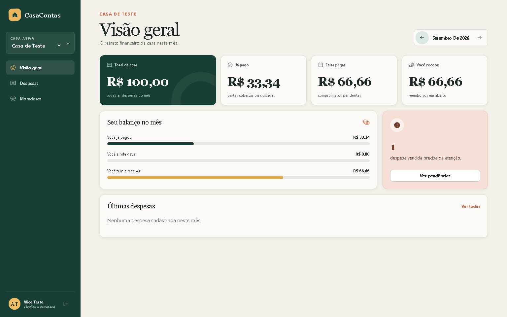
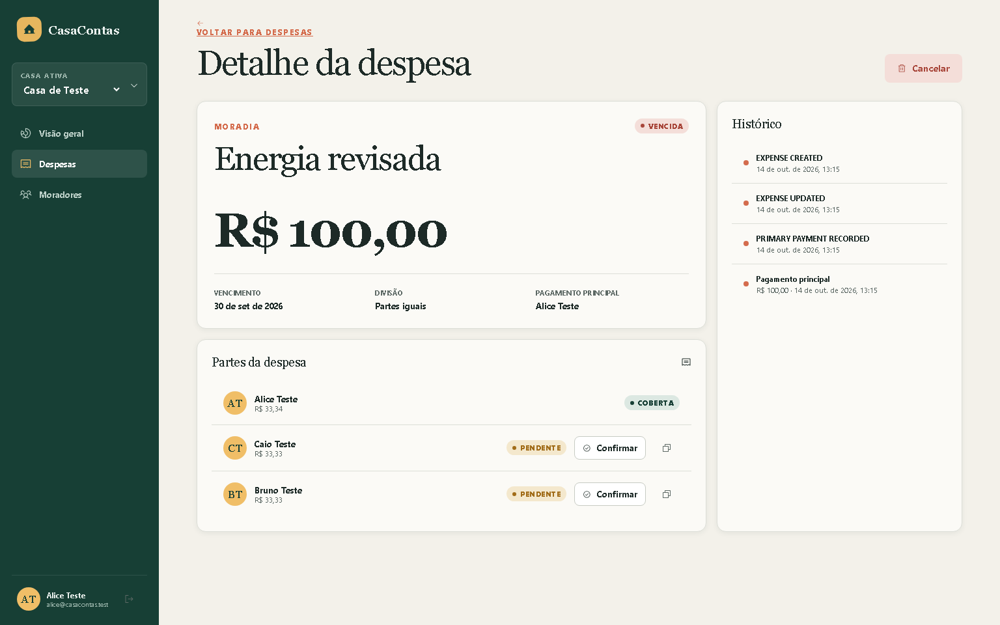
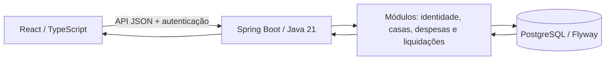

# CasaContas

CasaContas organiza, divide e acompanha despesas de casas compartilhadas com precisão de centavos, isolamento entre casas e histórico auditável.

O MVP P0 está implementado e passa por estabilização da integração e preparação de homologação. Consulte o [registro de continuidade](docs/implementation/STATUS.md) para a revisão validada, evidências e bloqueios atuais. A existência de código ou imagem não comprova aprovação para publicação.

## O que já funciona

- cadastro, login, JWT curto, refresh rotativo e logout;
- criação de casas, papéis, convites e remoção lógica de moradores;
- despesas iguais ou personalizadas, edição, cancelamento e filtros;
- pagamento principal, liquidação individual, reembolso e idempotência;
- painel mensal/individual, histórico de auditoria e mensagem de cobrança;
- interface responsiva para desktop e celular;
- PostgreSQL real, Flyway, OpenAPI, métricas, Docker e CI.

## Um exemplo de uso

Alice, Bruno e Caio dividem uma despesa de R$ 100,00. A divisão igual preserva
o total: R$ 33,34 + R$ 33,33 + R$ 33,33. Ao registrar quem pagou a conta principal,
o sistema acompanha as partes e os reembolsos sem repetir confirmações.

As telas abaixo são capturas da aplicação executada com navegador, API e
PostgreSQL reais em ambiente local isolado. Todos os moradores e valores são
dados sintéticos de teste; o exemplo usa setembro de 2026.





Para reproduzir as capturas, com Docker ativo, dependências frontend instaladas
e Chromium do Playwright disponível:

```powershell
node scripts/capture-demo.mjs
```

O comando executa a jornada completa, verifica reinício e restauração em banco
isolado e só então atualiza as imagens. No CI, as mesmas capturas fazem parte
do relatório da jornada real. O teste mantém seu volume sintético; não usa Neon
nem registros de usuários reais.

## Tecnologias e fluxo

O frontend usa React e TypeScript; a API é um monólito modular em Java 21/Spring
Boot, com Maven. PostgreSQL/Flyway persistem os registros e o histórico.
Render, Neon e Vercel são a topologia preparada para homologação.



A [arquitetura detalhada](docs/architecture/README.md) explica camadas, contratos
e decisões. Testes locais ou screenshots não aprovam automaticamente o ambiente
público; confira o [registro da revisão](docs/implementation/STATUS.md).

## Rodar com Docker

Pré-requisito: Docker Desktop com Compose v2.

```powershell
Copy-Item .env.example .env
docker compose up --build
```

Abra:

- aplicação: `http://localhost:3000`;
- API: `http://localhost:8080/api/v1`;
- Swagger UI: `http://localhost:8080/docs`;
- OpenAPI JSON: `http://localhost:8080/api-docs`;
- saúde: `http://localhost:8080/actuator/health`.

Os valores padrão são somente para desenvolvimento. Troque `POSTGRES_PASSWORD` e `JWT_SECRET` no `.env` antes de compartilhar qualquer ambiente.

## Imagens no GHCR

O workflow de publicação depende das verificações da mesma revisão na `main`.
PRs constroem imagens para validação. Antes de usar uma imagem em homologação,
confira o commit, o resultado de todos os checks e fixe seu digest. Tags antigas
de branches não são evidência de aprovação atual.

## Verificar

Para o ambiente de teste em Render, Neon e Vercel, siga a
[configuração por provedor](docs/operations/RENDER-NEON-VERCEL.md).
As credenciais reais pertencem exclusivamente aos segredos do Render.

```bash
make verify
make test-e2e
```

Sem `make`:

```powershell
cd backend
.\mvnw.cmd verify
cd ..\frontend
npm ci
npm run verify
npm run test:e2e
```

O backend exige Java 21 e Docker ativo porque os testes usam PostgreSQL 17.6 via Testcontainers. O frontend usa Node 22.20.0 no CI.

No Windows, com Docker ativo e Node instalado, os verificadores isolados evitam
depender do JDK selecionado na IDE e da velocidade da pasta sincronizada:

```powershell
./scripts/verify-backend.ps1
node scripts/verify-frontend.mjs
```

`npm run test:e2e` valida a interface com respostas de API simuladas. Os testes
Spring usam PostgreSQL real. A jornada de sistema usa navegador, API e PostgreSQL
sem interceptações, em banco próprio: `node scripts/test-system.mjs` (Chromium do
Playwright instalado em `frontend/`). Para instalá-lo, execute `npx playwright
install chromium` nessa pasta. O volume de teste permanece após a execução.

## Estrutura

- `backend/`: monólito modular Spring Boot, domínio e persistência;
- `frontend/`: React, TypeScript, páginas e testes;
- `docs/architecture/`: visão técnica e ADRs;
- `docs/api/examples.http`: chamadas executáveis;
- `docs/operations/`: procedimentos operacionais;
- `docs/security/`: modelo de ameaças;
- `docs/implementation/`: plano, evidências, rastreabilidade e backlog;
- `.github/`: templates, Dependabot e workflows.

Leia primeiro a [arquitetura](docs/architecture/README.md), a [rastreabilidade](docs/implementation/TRACEABILITY.md) e o [runbook](docs/operations/RUNBOOK.md). A [preparação de homologação](docs/operations/HOMOLOGACAO.md) descreve configuração, backup, restauração e limites de retorno entre versões.

Para contribuir, siga [CONTRIBUTING.md](CONTRIBUTING.md). O
[checklist de conquistas e colaboração](docs/implementation/ACHIEVEMENTS.md)
acompanha contribuições legítimas e evidências, sem substituir a revisão ou o CI.

## Evidências de qualidade

Resultados pertencem à revisão em que foram executados. Os números históricos
do MVP não aprovam mudanças posteriores. Consulte [STATUS.md](docs/implementation/STATUS.md),
[TDD_EVIDENCE.md](docs/implementation/TDD_EVIDENCE.md) e os checks do PR.

## Escopo

Somente requisitos P0 fazem parte deste MVP. Recorrência, pagamentos parciais, recuperação de senha, notificações automáticas e exportações estão no [backlog](docs/implementation/BACKLOG.md). A licença ainda depende de decisão explícita do proprietário.
